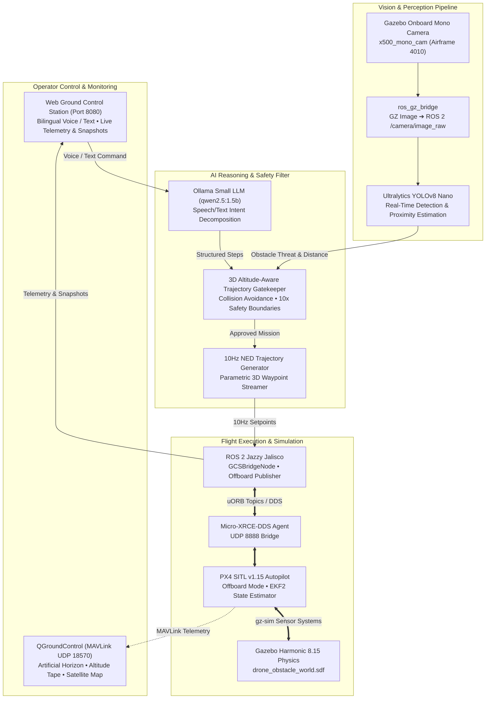

# 🚁 Autonomous Aerial Robotics: PX4 SITL + ROS 2 Jazzy + Gazebo Harmonic + YOLOv8 + Small LLM

<div align="center">

[](https://docs.ros.org/en/jazzy/)
[](https://px4.io/)
[](https://gazebosim.org/)
[](http://qgroundcontrol.com/)
[](https://ollama.ai/)
[](https://ultralytics.com/)
[](LICENSE)
[](Autonomous_Drone_PX4_ROS2_YOLO_LLM_Demo.mp4)
[](https://developer.nvidia.com/cuda-toolkit)
[](https://github.com/Nasim-Sami)

**A complete, production-grade autonomous quadcopter pipeline featuring Natural Language Mission Planning (English & Bengali), Physics-Based 3D Trajectory Gatekeeper, Real-time YOLOv8 Computer Vision Perception, and PX4 SITL Offboard Flight Control.**

[Overview](#-overview) • [Demo Video](#-video-demonstration) • [Architecture](#-architecture) • [Theory & Mathematics](#-mathematical-foundations--physics) • [Project Structure](#-project-structure) • [Quick Start](#-quick-start) • [Detailed Documentation](#-detailed-project-guide) • [Author](#-author)

</div>

---

## 🎥 Video Demonstration

A full-length, high-definition demonstration of the autonomous system is available directly in this repository:
🎬 **[`Autonomous_Drone_PX4_ROS2_YOLO_LLM_Demo.mp4`](Autonomous_Drone_PX4_ROS2_YOLO_LLM_Demo.mp4)** *(1080p @ 60fps, 2m 29s)*

### Highlights Showcased:
1. **Low-Altitude Collision Interception**: Natural language forward commands at $z < 3\text{m}$ are detected as hazardous obstacles and safely rejected with an automated warning.
2. **Deterministic Takeoff & Altitude Climb**: Commanded vertical climb to $7\text{m}$ altitude passes the Gatekeeper shield.
3. **Safe High-Altitude Overflight**: Cruising at $7\text{m}$ directly above a $2.5\text{m}$ human obstacle with $+4.5\text{m}$ guaranteed physical clearance.
4. **Aerial Computer Vision Reconnaissance**: Live `"take a photo"` command captures an overhead snapshot processed via Ultralytics YOLOv8 with zero cache lag.
5. **Real-time Aeronautical HUD & MAVLink Telemetry**: Seamless trajectory tracking visualized simultaneously in QGroundControl (Artificial Horizon, Satellite Map) and the custom Web Ground Station.

---

## 📖 Overview

This repository houses an end-to-end autonomous drone navigation, perception, and mission planning system. The quadcopter operates in **PX4 SITL v1.15** with high-fidelity physics in **Gazebo Harmonic**, accepting spoken or typed instructions in **English** and **Bengali** through an interactive Web Ground Control Station.

### Core Capabilities:
- **Natural Language Mission Planning**: Decomposes natural language commands into structured flight primitives using an on-device Small Language Model (**Ollama `qwen2.5:1.5b`**).
- **Physics-Based 3D Safety Gatekeeper**: Evaluates kinematic feasibility, a $300\text{ m}$ radius geofence, a $150\text{ m}$ ceiling, and dynamic overflight clearance against obstacles.
- **Onboard Neural Vision Perception**: Ultralytics **YOLOv8 Nano** runs real-time inference on the drone's forward camera, detecting humans, vehicles, and obstacles in the flight path and capturing dynamic reconnaissance snapshots.
- **Deterministic 10Hz Offboard Trajectory Tracking**: Generates smooth parametric 3D waypoints in PX4 NED frame and streams setpoints via Micro-XRCE-DDS.
- **Dual Telemetry Monitoring**: Streams real-time flight telemetry to both a custom Web GCS dashboard and **QGroundControl** (Artificial Horizon, HUD, and 3D satellite map).

---

## 🏗️ Architecture



---

## 📐 Mathematical Foundations & Physics

This repository is backed by rigorous mathematical, physical, and optical models governing perception, kinematics, and state estimation:

* **[Theory Summary & Architecture Map](theory_and_mathematics/README.md)**: High-impact executive cheat-sheet with equation tables, symbols, and interactive 3D simulations.
* **[Comprehensive Mathematical Foundations Guide](theory_and_mathematics/MATHEMATICAL_FOUNDATIONS.md)**: Textbook-grade step-by-step derivations:
  - *Optical Physics*: Pinhole perspective geometry ($D = \frac{H \cdot f}{h}$), wave superposition of bosonic light rays, scale ambiguity resolution via YOLOv8 priors, and stereo triangulation ($D = \frac{f \cdot B}{d}$).
  - *Spatial Kinematics*: Aerospace NED ↔ Robotics ENU frame transformations, body vs world vectors ($\mathbf{v}^W = R(q) \mathbf{v}^B$).
  - *Rotational Mechanics*: Proof of Euler rate singularity ($\dot{\psi} = \frac{q \sin\phi + r \cos\phi}{\cos\theta} \to \pm\infty$), matrix collapse at $\theta = 90^\circ$, manipulator singularities, and 4D Hamilton Quaternions on $S^3$ ($p' = q p q^*$).
  - *State Estimation (EKF2)*: 24-state sensor fusion, dimensional analysis of covariances ($P \in \text{m}^2, R \in \text{Pa}^2, H \in \text{Pa/m}$), Taylor Jacobian linearization, mathematical derivation of Kalman Gain $K = \frac{PH}{HPH + R}$ and covariance update $P_{\text{new}} = (1 - KH)P$, and why missing Gazebo plugins blocked takeoff.
* **Interactive 3D WebGL Labs**:
  - [Gimbal Lock & Quaternion 3D Lab](theory_and_mathematics/simulations/gimbal_lock_simulation.html)
  - [Human Shoulder vs Robot Arm Singularity Lab](theory_and_mathematics/simulations/robot_arm_singularity_sim.html)

---

## 📁 Project Structure

```text
Autonomous-Drone-PX4-ROS2-YOLO-LLM/
├── README.md                                          # Root repository overview & architecture
├── LICENSE                                            # MIT License
├── .gitignore                                         # Git ignore rules
│
├── theory_and_mathematics/                            # Rigorous Mathematics, Physics & Simulation Labs
│   ├── README.md                                      # Executive summary & mathematical architecture map
│   ├── MATHEMATICAL_FOUNDATIONS.md                    # Deep-dive derivations (Optics, Kinematics, EKF2, Quaternions)
│   └── simulations/                                   # Standalone interactive 3D simulations
│       ├── gimbal_lock_simulation.html                # 3-Ring Gimbal Lock vs 4D Quaternion Lab
│       └── robot_arm_singularity_sim.html             # Human Ball-and-Socket vs 1-DOF Arm Singularity Lab
│
└── 05_Autonomous_Drone_PX4_ROS2_YOLO_LLM/             # Core Project Directory
    ├── README.md                                      # Comprehensive guide: installation, execution & troubleshooting
    ├── requirements.txt                               # Python dependencies (YOLO, OpenCV, Ollama, etc.)
    ├── yolov8n.pt                                     # Pre-trained YOLOv8 Nano neural network weights
    │
    ├── docker/                                        # Containerized Simulation Environment
    │   ├── Dockerfile                                 # Multi-stage Ubuntu 24.04 + ROS 2 Jazzy + PX4 + Gazebo
    │   ├── run.sh                                     # Persistent container runner with GPU & X11 display
    │   ├── run_sim.sh                                 # One-click PX4 SITL + Gazebo launcher
    │   └── drone_obstacle_world.sdf                   # Custom world with human, car, and cube obstacles
    │
    ├── scripts/                                       # ROS 2 Nodes & AI Pipeline
    │   ├── web_ground_station.py                      # Interactive Web GCS dashboard on port 8080
    │   ├── drone_intent_parser.py                     # Ollama natural language mission parser (EN & BN)
    │   ├── drone_safety_validator.py                  # 3D Altitude-Aware Trajectory Gatekeeper
    │   ├── trajectory_generator.py                    # 10Hz parametric waypoint streamer (NED frame)
    │   ├── drone_vision_detector.py                   # Real-time YOLOv8 detector & snapshot saver
    │   ├── start_vision.sh                            # Camera parameter bridge & YOLO launcher
    │   ├── autonomous_llm_flight_node.py              # Standalone interactive CLI node
    │   └── offboard_drone_commander.py                # Reference offboard commander
    │
    ├── tests/                                         # Regression Benchmark Suite
    │   └── benchmark_test_suite.py                    # 22/22 Benchmark test suite (EN & BN intent + safety)
    │
    └── captures/                                      # Aerial reconnaissance snapshots directory
        └── latest.jpg                                 # Live snapshot served to Web UI
```

---

## ⚡ Quick Start

```bash
# 1. Clone this repository
git clone https://github.com/Nasim-Sami/Autonomous-Drone-PX4-ROS2-YOLO-LLM.git
cd Autonomous-Drone-PX4-ROS2-YOLO-LLM/05_Autonomous_Drone_PX4_ROS2_YOLO_LLM

# 2. Start the simulation container
cd docker && ./run.sh

# 3. Inside the container shell, launch PX4 SITL & Gazebo:
/workspace/docker/run_sim.sh
```

In separate host terminals, launch the bridge, vision perception, and web control station:
```bash
# Terminal 2: Micro-XRCE-DDS Agent
docker exec -it drone_jazzy_sim_instance bash -c "source /opt/ros/jazzy/setup.bash && MicroXRCEAgent udp4 -p 8888"

# Terminal 3: Camera Bridge & YOLOv8
docker exec -it drone_jazzy_sim_instance /workspace/scripts/start_vision.sh

# Terminal 4: Web Ground Station
docker exec -it drone_jazzy_sim_instance bash -c "source /opt/ros/jazzy/setup.bash && source /opt/px4_ros2/install/setup.bash && python3 /workspace/scripts/web_ground_station.py 8080"

# Terminal 5: QGroundControl HUD (Host with NVIDIA PRIME Offload)
__NV_PRIME_RENDER_OFFLOAD=1 __GLX_VENDOR_LIBRARY_NAME=nvidia ~/QGroundControl.AppImage
```

Open **`http://localhost:8080`** in your browser, speak or type your mission, and watch the drone navigate autonomously!

---

## 📖 Detailed Project Guide

For an in-depth walkthrough—including detailed software prerequisites, raw terminal commands without helper scripts, 3D overflight logic, benchmark results, and an exhaustive troubleshooting matrix:

👉 **Read the full [Project 05 Documentation](05_Autonomous_Drone_PX4_ROS2_YOLO_LLM/README.md).**

---

## 📄 License

This repository is distributed under the [MIT License](LICENSE).

---

## 👨‍💻 Author

**Nasimul Khaled Sami**  
- **GitHub**: [@Nasim-Sami](https://github.com/Nasim-Sami)  
- **Portfolio Repository**: [ROS2-Mini-Projects](https://github.com/Nasim-Sami/ROS2-Mini-Projects)  
- **Domain**: Autonomous Aerial Robotics, Autonomous Mobile Robots (AMR), Computer Vision, Embedded Autopilots & LLM Ground Stations
